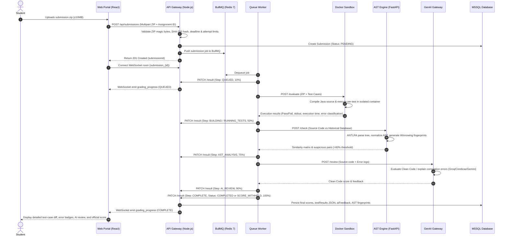

## project member:
Nguyễn Văn An
Nguyễn Trí Thiện
Trần Quốc Thịnh
Trương Gia Huy
Hàng Võ Minh Nhật

# AITA-INTELLIGENT

**AI-Powered Teaching Assistant & AST Code Analytics Platform**

> **SWP391 – Software Development Project, FPT University, Fall 2026**  
> **Development Team:** SWP391 – Group 3  
> **Architecture:** Multi-service Monorepo (Node.js/Express, React Vite, Python FastAPI, BullMQ, Docker Sandbox, MSSQL)

---

## 📌 Executive Summary & Key Problems Solved

**AITA-Intelligent** is an automated, AI-driven programming education platform built to solve 3 core challenges in university Computer Science education:

1. **Labor-Intensive Manual Grading & Execution Inconsistencies:** Lecturers spend excessive hours testing and compiling submissions across large classes. AITA automates test-case execution safely within containerized, resource-constrained Docker sandboxes.
2. **Sophisticated Source Code Fraud (AI-Assisted & Obfuscated Plagiarism):** Traditional text/token-based comparison tools (MOSS, JPlag) struggle against modern code obfuscation (variable renaming, method reordering, structure mutations). AITA parses code into Abstract Syntax Trees (AST) using ANTLR4 and applies the Winnowing algorithm to detect structural code clones.
3. **Delayed Feedback & Uninformative Compiler Errors:** Novice students struggle with cryptic compiler outputs. AITA integrates a multi-provider GenAI pipeline with Chain-of-Thought prompting to deliver pedagogical error explanations, Clean Code reviews (0–100 scale), and actionable recommendations.

---

## 🏗️ System Architecture & Subsystem Mapping

```
Client Tier           →  Web Portal (React 19 + Vite + Tailwind CSS) [PWA-Ready]
Real-Time Gateway     →  WebSocket Server (Socket.io) for live grading progress (6-step pipeline)
Core API Gateway      →  Node.js (v20+) + Express + TypeScript + Prisma ORM
Async Processing Tier →  Redis 7 + BullMQ Queue Worker (Orchestrator & Dispatcher)
Grading Execution     →  Module 2: Self-hosted Docker Sandbox (Isolated Java 17 runtime, cgroups, memory/PIDs limits)
Plagiarism Detection  →  Module 4: AST Winnowing Engine (Python 3.11+, FastAPI, ANTLR4 Java Grammar)
AI Review Tier        →  Module 3: GenAI Gateway (Multi-Key Rotation, Dual-Provider Fallback: Groq / Cerebras / Gemini)
Team Contribution     →  Module 5: Git Analytics Engine (Commit frequency, LOC, Free-Rider Detection)
Persistence Tier      →  Microsoft SQL Server 2019+ (13 Relational Models) + Redis Cache
```

### Core Subsystems & Member Ownership

| # | Subsystem | Functional Scope | Key Technologies | Lead Member |
|---|---|---|---|---|
| **1** | **Portal & Auth / Management** | User authentication (Google OAuth 2.0 & JWT), Role-based authorization (Student / Lecturer / Admin), Class management, Assignment wizard (parsing DOCX/PPTX/PDF), Manual code review & regrading modal, Grade history audit | React 19, Vite, Tailwind CSS, Lucide, `@react-oauth/google`, Express, Prisma | **Nguyễn Văn An** |
| **2** | **Code Execution Engine** | Containerized sandbox auto-grading, resource isolation (512MB RAM, 1.0 CPU, 64 PIDs limit), security attack defense (fork bombs, infinite loops, disallowed syscalls, unauthorized FS access) | Docker Engine API (Dockerode), Node.js, Linux cgroups, tar-stream, AdmZip | **Nguyễn Trí Thiện** |
| **3** | **GenAI Core & Review Hub** | Automated assignment draft & rubric generation, semantic Clean Code quality evaluation (0–100), pedagogical compilation error explanation, multi-provider fallback & latency-budget circuit breaker | TypeScript, LangChain/LLM Providers (Groq, Cerebras, Gemini), Prompt Engineering (CoT, Few-Shot) | **Trương Gia Huy** |
| **4** | **AST Plagiarism Detection** | Structural source code plagiarism detection, ANTLR4 Java parsing, subtree normalization, Winnowing fingerprinting algorithm, pairwise similarity matrix calculation | Python 3.11, FastAPI, ANTLR4 (`antlr4-python3-runtime`), NumPy, Uvicorn | **Hàng Võ Minh Nhật** |
| **5** | **Redis Queue & Git Analytics** | Centralized background job coordination, end-to-end pipeline execution (Sandbox → AST → AI → Callback), dead-letter handling, student Git team contribution analytics & free-rider detection | BullMQ, Redis 7, Simple-Git, TypeScript, Vitest, Pino Logger | **Trần Quốc Thịnh** |

---

## ⚡ End-to-End Submission & Grading Flow



---

## 💻 Tech Stack & Dependencies

### Monorepo Structure (`apps/*`)
- **`apps/api` (Backend & Gateway):**
  - Node.js 20+, Express 4.21, TypeScript 5.6
  - Prisma ORM 5.22, Microsoft SQL Server Client (`tedious`)
  - Socket.io 4.8 (Realtime updates)
  - Google Auth Library & JWT (Authentication)
  - AdmZip, JSZip, Multer, Mammoth, OfficeParser, PDF-Parse (Document parsing & ZIP extraction)
- **`apps/web` (Frontend Web App):**
  - React 19, Vite 5, React Router 7
  - Tailwind CSS 4, Lucide React
  - Socket.io Client
  - Google OAuth (`@react-oauth/google`)
- **`apps/queue-worker` (Async Pipeline & Git Metrics):**
  - Node.js 20+, TypeScript, BullMQ 5.12, Redis 7 (`ioredis`)
  - Axios (HTTP microservice communication)
  - Pino logger, Vitest (Unit & Integration testing)
- **`apps/sandbox-engine` (Container Execution):**
  - Node.js 20+, Dockerode 4 (Docker Engine API)
  - Tar-stream, AdmZip
  - Custom Java 17 image (`aita-sandbox-java17:latest`)
- **`apps/ast-engine` (Plagiarism Analysis):**
  - Python 3.11+, FastAPI, Uvicorn
  - ANTLR4 runtime (`antlr4-python3-runtime`)
  - Winnowing fingerprinting algorithm
- **`apps/mobile`:**
  - Reserved architecture module for native mobile extension (React Native/Expo).

---

## 🗄️ Database Architecture (MSSQL & Prisma)

The database schema (`apps/api/prisma/schema.prisma`) comprises **13 structured relational models**:

1. **`User`**: Base identity (Email, Full Name, Role: `STUDENT`, `LECTURER`, `ADMIN`, Password Hash, Google ID).
2. **`Student` / `Lecturer` / `Admin`**: Role-specific profile extensions.
3. **`Class`**: Academic course units managed by Lecturers.
4. **`ClassStudent`**: Many-to-many enrollment mapping students to classes.
5. **`Assignment`**: Coding assignments with deadlines, programming language specification, and descriptions.
6. **`TestCase`**: Test case configurations (`inputData`, `expectedOutput`, `scoreWeight`, and `isHidden` flag for unseen evaluation tests).
7. **`Submission`**: Uploaded archives tracking lifecycle status (`PENDING`, `BUILDING`, `RUNNING_TESTS`, `COMPLETED`, `SCORE_WITHHELD`, `COMPILATION_ERROR`, `TIMEOUT`, `SECURITY_VIOLATION`, `FAILED`), storing `automaticScore`, `manualScore`, `totalScore`, `fileUrl`, `fileHash` (SHA-256), `testResults` JSON, and `aiFeedback`.
8. **`ASTFingerprint`**: Winnowing hash tokens, line positions, and AST token counts.
9. **`PlagiarismMatch`**: Pairwise match records with similarity percentage and severity classification (`SAFE`, `SUSPICIOUS`, `DANGER`).
10. **`Appeal`**: Grade dispute workflow enabling students to request reviews and lecturers to resolve appeals.
11. **`ScoreAuditLog`**: Regulatory audit log (Risk R03) recording every manual grade change (editor, old score, new score, justification reason, timestamp).

---

## 🚀 Key Features by User Role

### 👨‍🎓 For Students
- **Single Sign-On (SSO):** Sign in with institutional Google account (`@fpt.edu.vn` / `@fe.edu.vn`) or credentials.
- **Interactive Submission Hub:** Drag-and-drop `.zip` upload with automatic client/server validation.
- **Real-Time Progress Stepper:** 6-step visual feedback tracking background pipeline state.
- **Detailed Test Case Results (US-04):** View passed/failed assertions, line-by-line diff view (Expected vs. Actual), execution duration, and categorised error types (`WRONG_ANSWER`, `COMPILE_ERROR`, `RUNTIME_ERROR`, `TIMEOUT`, `MLE`). Hidden test cases safeguard confidential test data.
- **AI Code Quality Review:** Actionable feedback on Clean Code conventions, edge-case logic, and input handling.
- **Grade Appeals (US-05 / US-10):** Submit formal appeals directly from the grading results page.

### 👩‍🏫 For Lecturers
- **Class & Student Roster Management:** Bulk import students via Excel/CSV, manage class codes.
- **AI-Powered Assignment Wizard (US-08):** Generate assignment requirements and sample test suites from keywords, or parse requirements from uploaded DOCX, PPTX, or PDF files.
- **Assignment Cloning & Reusability (UC-02):** Clone assignments across semesters and classes.
- **Class Analytics & Plagiarism Radar:** Monitor class score distribution, average performance, and top suspect pairs detected by the AST Winnowing engine.
- **Manual Review & Regrading (Member 1):**
  - **In-Browser Code Viewer:** Browse file/folder structure and read student source code with syntax highlighting (read-only).
  - **Download ZIP:** Download the original submitted archive.
  - **Manual Regrade Modal:** Compare automatic Sandbox score vs. current official score, input new score (0–10) with mandatory justification reason and confirmation step.
  - **Grade History Timeline:** View historical score adjustments recorded in `ScoreAuditLog`.
- **Appeals Resolution:** Review student arguments and approve score revisions or reject disputes.

### 🛡️ System & Sandbox Security Measures
- **Network Isolation:** Sandbox containers run with disconnected network (`--network none`) to prevent exfiltration.
- **Resource Constraints:** Enforced memory ceilings (512MB RAM, 64MB swap), CPU quotas (1.0 core), and PIDs limits (64 processes) to neutralize fork bombs.
- **Timeout Watchdog:** 30s overall pipeline timeout and 5s per-test-case cutoff to prevent infinite loops.
- **IDOR & Data Privacy (ADR-001):** Students only see similarity percentages for their own work; matched code fragments and counterpart student identities are restricted to Lecturers and Admins.

---

## ⚙️ Installation & Local Development Setup

### 1. Prerequisites
- **Node.js:** v20.x or higher
- **npm:** v10.x or higher (or pnpm/yarn)
- **Python:** v3.11 or higher
- **Docker Desktop:** Running (required for Sandbox engine and containerized dependencies)
- **Microsoft SQL Server:** 2019+ running on port 1433 (or via Docker)
- **Redis:** v7+ running on port 6379 (or via Docker)

### 2. Environment Configuration
Create the corresponding `.env` files based on the provided examples:

```bash
# 1. API Gateway (.env)
cp apps/api/.env.example apps/api/.env

# 2. Web Portal (.env)
cp apps/web/.env.example apps/web/.env

# 3. Queue Worker (.env)
cp apps/queue-worker/.env.example apps/queue-worker/.env

# 4. Sandbox Engine (.env)
cp apps/sandbox-engine/.env.example apps/sandbox-engine/.env
```

Ensure your `apps/api/.env` contains your SQL Server connection:
```ini
PORT=5000
DATABASE_URL="sqlserver://localhost:1433;database=aita_db;user=sa;password=YourPassword123;encrypt=true;trustServerCertificate=true"
JWT_SECRET="your_jwt_secret_key"
INTERNAL_API_KEY="aita_internal_secret_key_2026"
GOOGLE_CLIENT_ID="your_google_client_id.apps.googleusercontent.com"
```

### 3. Database Initialization
```bash
# Generate Prisma Client
cd apps/api
npx prisma generate

# Apply migrations / push schema to MSSQL
npx prisma db push
```

### 4. Running the Complete System

#### Option A: Automated Windows Launcher (Recommended)
Run the automated batch script from the project root:
```cmd
startup.bat
```
To run full setup (install dependencies, generate Prisma client, push database, and launch all services):
```cmd
startup.bat setup
```
To terminate all background service windows:
```cmd
startup.bat stop
```

#### Option B: Manual Multi-Service Startup

1. **Start Backend API (Port 5000):**
   ```bash
   cd apps/api
   npm install
   npm run dev
   ```

2. **Start Frontend Portal (Port 3000):**
   ```bash
   cd apps/web
   npm install
   npm run dev
   ```

3. **Start AST Plagiarism Engine (Port 8000):**
   ```bash
   cd apps/ast-engine
   python -m venv .venv
   .venv\Scripts\activate      # On Windows
   # source .venv/bin/activate # On Linux/macOS
   pip install -r requirements.txt
   python -m uvicorn ast_engine.main:app --app-dir src --port 8000
   ```

4. **Start BullMQ Queue Worker:**
   ```bash
   cd apps/queue-worker
   npm install
   npm run dev
   ```

5. **Start Sandbox Engine (Port 5001 - Optional when running external Docker grading):**
   ```bash
   cd apps/sandbox-engine
   npm install
   npm run dev
   ```

#### Option C: Docker Compose (Infrastructure Stack)
Spin up Microsoft SQL Server 2019, Redis 7, Queue Worker, and AST Engine in Docker:
```bash
docker compose up -d
```

---

## 🧪 Testing & Code Quality

Each workspace contains tailored test suites and strict type validation:

```bash
# 1. Typecheck all workspaces
npm run build --workspace=@aita/api
npm run build --workspace=web
npm run build --workspace=@aita/queue-worker
npm run build --workspace=@aita/sandbox-engine

# 2. Queue Worker & Pipeline tests (Vitest)
npm test --workspace=@aita/queue-worker

# 3. Sandbox Attack & Security tests (Jest)
npm run sandbox:test
npm run attack-test

# 4. GenAI Provider Benchmark
npm run test:genai --workspace=@aita/api

# 5. AST Engine test suite (Pytest)
cd apps/ast-engine
pytest tests/
```

---

## 📂 Repository Layout

```
SWP391_Group3/
├── apps/
│   ├── api/             # Express API Gateway, Prisma ORM, WebSocket server, GenAI hub
│   ├── web/             # React 19 + Vite Frontend SPA (Lecturer & Student Dashboards)
│   ├── queue-worker/    # BullMQ async processing queue & Git Analytics
│   ├── sandbox-engine/  # Docker autograding engine & security isolation controls
│   ├── ast-engine/      # Python ANTLR4 AST parser & Winnowing plagiarism detector
│   └── mobile/          # Future mobile application module (React Native)
├── docs/                # Comprehensive SRS v1.2, Architecture diagrams, ERD, ADRs, user manuals
├── packages/            # Shared libraries and configuration modules
├── docker-compose.yml   # Multi-container orchestration (MSSQL, Redis, AST Engine, Worker)
├── startup.bat          # One-click Windows launcher for all local services
├── start_demo.bat       # Quick demo launcher with Ngrok tunnel
├── package.json         # Root npm workspace manifest
└── README.md            # Main project documentation
```

---

## 📚 References & Academic Citations

1. **Schleimer, S., Wilkerson, D. S., & Aiken, A. (2003).** *"Winnowing: Local Algorithms for Document Fingerprinting"*. In Proceedings of the 2003 ACM SIGMOD International Conference on Management of Data, pp. 76–85.
2. **Parr, T. (2010).** *"Language Implementation Patterns: Techniques for Implementing Domain-Specific Languages and Compilers"*. Pragmatic Bookshelf.
3. **Sommerville, I. (2016).** *"Software Engineering"*, 10th Edition. Pearson Education.
4. **Docker Inc. (2026).** *"Docker Engine API Documentation & Security Best Practices"*. https://docs.docker.com/engine/api/
