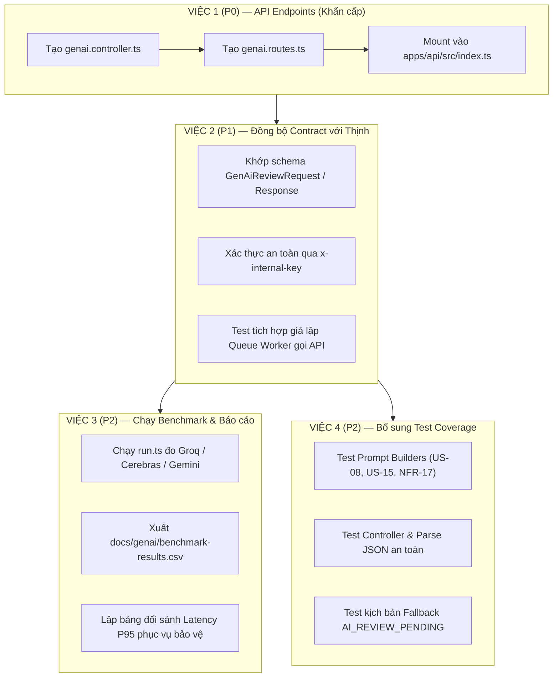

# 🚀 KẾ HOẠCH HÀNH ĐỘNG CHI TIẾT — PHÂN HỆ 3: GENAI CORE & REVIEW HUB

> **Người thực hiện:** Dev Huy (Phân hệ 3)  
> **Dự án:** AITA-Intelligent Automated Grading & Review System (SWP391 Group 3)  
> **Căn cứ kế hoạch:** `docs/05_plan/task_milestone_3_10_removenvidia.md`  
> **Ngày lập:** 14/10/2026  

---

## 📌 1. TỔNG QUAN TÌNH TRẠNG HIỆN TẠI

Module GenAI tại `apps/api/src/services/genai/` đã hoàn thiện rất tốt về mặt kiến trúc lõi (~95%):
- ✅ **Strategy Pattern:** `BaseProvider` → `GroqProvider` (Llama-3.3-70B), `CerebrasProvider` (Llama-3.3-70B), `GeminiProvider` (Gemini-2.0-Flash).
- ✅ **Gateway 2 tầng Fallback:** Primary (Groq) → Fallback (Cerebras) → Safe return `AI_REVIEW_PENDING` (không làm crash pipeline chấm bài).
- ✅ **3 bộ Prompt Templates:**
  - `buildAssignmentGenerationPrompt` (US-08: Giảng viên tạo đề bài).
  - `buildCleanCodeReviewPrompt` (US-15: Chấm Clean Code 0-100 kèm nhận xét tiếng Việt).
  - `buildErrorExplanationPrompt` (NFR-17: Giải thích lỗi biên dịch tiếng Việt dễ hiểu).
- ✅ **Script Benchmark:** `apps/api/src/services/genai/benchmark/run.ts` sẵn sàng đo đạc 3 providers.
- ✅ **Unit Test Gateway:** 8 hàm test bao phủ cơ chế fallback, timeout, và non-retryable error.

⚠️ **LỖ HỔNG LỚN NHẤT:** Toàn bộ module đang là "thư viện cô lập" trong `apps/api/src/services/genai/`. Chưa có Route/Controller nào expose ra ngoài, dẫn tới Queue Worker (Thịnh) gọi `POST /api/review` sẽ gặp **404 Not Found**.

---

## 🗺️ 2. SƠ ĐỒ LỘ TRÌNH 4 NHIỆM VỤ



---

## 🔴 VIỆC 1: XÂY DỰNG & MOUNT API ENDPOINTS (Ưu tiên P0)

### 1. Mục tiêu
Tạo bộ phận Controller và Router để tiếp nhận yêu cầu từ hệ thống (Queue Worker và Giảng viên qua Portal).

### 2. Thiết kế chi tiết mã nguồn

#### File 1: `apps/api/src/controllers/genai.controller.ts`
Chức năng chính:
- Nhận request, tiền xử lý và validate tham số.
- Gọi `AIGateway` với prompt tương ứng.
- Parse JSON an toàn từ phản hồi LLM (lọc bỏ các tag markdown \`\`\`json nếu LLM sinh kèm).
- Trả kết quả chuẩn JSON.

```typescript
import { Request, Response } from "express";
import {
  AIGateway,
  buildCleanCodeReviewPrompt,
  buildErrorExplanationPrompt,
  buildAssignmentGenerationPrompt,
} from "../services/genai/index.js";

// Khởi tạo Gateway Singleton dùng chung
const gateway = new AIGateway();

/**
 * Tiện ích làm sạch chuỗi JSON sinh ra từ LLM
 */
function extractJsonFromLlm(rawText: string): any {
  let cleaned = rawText.trim();
  if (cleaned.startsWith("```json")) {
    cleaned = cleaned.replace(/^```json\s*/i, "").replace(/\s*```$/, "");
  } else if (cleaned.startsWith("```")) {
    cleaned = cleaned.replace(/^```\s*/, "").replace(/\s*```$/, "");
  }
  return JSON.parse(cleaned.trim());
}

/**
 * POST /api/review
 * Dành cho Queue Worker (Thịnh) gọi để chấm Clean Code và giải thích lỗi
 */
export const reviewSubmission = async (req: Request, res: Response) => {
  const {
    submissionId,
    language,
    sourceCode = "",
    isCompilationError = false,
    compileOutput = "",
  } = req.body;

  if (!submissionId || !language) {
    return res.status(400).json({
      success: false,
      message: "Thiếu thông tin bắt buộc: submissionId, language.",
    });
  }

  try {
    let cleanCodeScore = 100;
    let feedback = "Mã nguồn sạch, tuân thủ tốt các quy chuẩn.";
    let compilationExplanation: string | undefined = undefined;

    // 1. Nếu là lỗi biên dịch (NFR-17)
    if (isCompilationError) {
      cleanCodeScore = 0;
      feedback = "Bài nộp không thể biên dịch thành công.";

      const promptData = buildErrorExplanationPrompt(compileOutput, sourceCode, language);
      const result = await gateway.chat(promptData);

      if (result.status === "COMPLETED" && result.data) {
        try {
          const parsed = extractJsonFromLlm(result.data.content);
          compilationExplanation = `[${parsed.errorType || "Lỗi biên dịch"}] ${parsed.explanation || ""}\n💡 Gợi ý khắc phục: ${parsed.suggestion || ""}`;
        } catch {
          compilationExplanation = result.data.content;
        }
      } else {
        compilationExplanation = "Không thể tạo giải thích lỗi do hệ thống AI đang bận.";
      }

      return res.status(200).json({
        cleanCodeScore,
        feedback,
        compilationExplanation,
      });
    }

    // 2. Chấm Clean Code bình thường (US-15)
    if (!sourceCode.trim()) {
      return res.status(200).json({
        cleanCodeScore: 0,
        feedback: "Không tìm thấy nội dung mã nguồn để đánh giá.",
      });
    }

    const promptData = buildCleanCodeReviewPrompt(sourceCode, language);
    const result = await gateway.chat(promptData);

    if (result.status === "COMPLETED" && result.data) {
      try {
        const parsed = extractJsonFromLlm(result.data.content);
        cleanCodeScore = typeof parsed.score === "number" ? parsed.score : 80;
        
        const commentsText = Array.isArray(parsed.comments)
          ? parsed.comments.join("\n- ")
          : "";
        feedback = `${parsed.summary || "Đánh giá chất lượng mã nguồn:"}\n\nChi tiết nhận xét:\n- ${commentsText}`;
      } catch {
        feedback = result.data.content;
      }
    } else {
      // AI_REVIEW_PENDING (Cả 2 provider đều fail) -> Trả fallback an toàn, không vỡ pipeline
      return res.status(200).json({
        cleanCodeScore: 0,
        feedback: "AI Review Pending: Đang chờ phân tích lại do hệ thống AI quá tải hoặc bảo trì.",
      });
    }

    return res.status(200).json({
      cleanCodeScore,
      feedback,
    });
  } catch (error: any) {
    return res.status(200).json({
      cleanCodeScore: 0,
      feedback: `AI Review Pending: ${error?.message || "Lỗi không xác định"}`,
    });
  }
};

/**
 * POST /api/assignments/generate
 * Dành cho Giảng viên sinh đề bài tự động (US-08)
 */
export const generateAssignment = async (req: Request, res: Response) => {
  try {
    const { topic, language, difficulty = "medium" } = req.body;

    if (!topic || !language) {
      return res.status(400).json({
        success: false,
        message: "Vui lòng cung cấp chủ đề (topic) và ngôn ngữ (language).",
      });
    }

    const promptData = buildAssignmentGenerationPrompt(topic, language, difficulty);
    const result = await gateway.chat(promptData);

    if (result.status === "COMPLETED" && result.data) {
      const parsed = extractJsonFromLlm(result.data.content);
      return res.status(200).json({
        success: true,
        data: parsed,
      });
    }

    return res.status(503).json({
      success: false,
      message: "Không thể sinh đề bài lúc này do dịch vụ AI quá tải. Vui lòng thử lại sau.",
    });
  } catch (error: any) {
    return res.status(500).json({
      success: false,
      message: error?.message || "Lỗi máy chủ khi sinh đề bài.",
    });
  }
};

/**
 * GET /api/stats
 * Kiểm tra thống kê hạn ngạch và sức khỏe Gateway
 */
export const getAiStats = (req: Request, res: Response) => {
  return res.status(200).json({
    success: true,
    data: gateway.getStats(),
  });
};
```

#### File 2: `apps/api/src/routes/genai.routes.ts`
```typescript
import { Router } from "express";
import {
  reviewSubmission,
  generateAssignment,
  getAiStats,
} from "../controllers/genai.controller.js";
import {
  authenticateJWT,
  authorizeRole,
  requireInternalApiKey,
} from "../middlewares/auth.middleware.js";

const router = Router();

// 1. Endpoint nội bộ cho Queue Worker
router.post("/review", requireInternalApiKey, reviewSubmission);

// 2. Endpoint cho Giảng viên sinh đề bài tự động
router.post(
  "/assignments/generate",
  authenticateJWT,
  authorizeRole("LECTURER", "ADMIN"),
  generateAssignment
);

// 3. Endpoint giám sát sức khỏe Gateway
router.get("/stats", requireInternalApiKey, getAiStats);

export default router;
```

#### File 3: Cập nhật `apps/api/src/index.ts`
Mount `genaiRoutes` vào đường dẫn `/api`:
```typescript
import genaiRoutes from "./routes/genai.routes.js";
// ...
app.use("/api", genaiRoutes);
```

---

## 🟡 VIỆC 2: ĐỒNG BỘ CONTRACT VỚI THỊNH (Ưu tiên P1)

### 1. Đối chiếu Contract giữa Queue Worker và API
Thịnh đã xây dựng sẵn file `apps/queue-worker/src/contracts/genai.contract.ts`:

```typescript
// Request format
export interface GenAiReviewRequest {
  submissionId: string;
  language: string;
  fileRelativePath?: string;
  sourceCode?: string;
  sandboxSummary?: {
    outcome: string;
    passedTests: number;
    totalTests: number;
    executionTimeMs: number;
  };
  isCompilationError?: boolean;
  compileOutput?: string;
}

// Response format
export interface GenAiReviewResponse {
  cleanCodeScore: number;                 // Điểm số 0 - 100
  feedback: string;                       // Nhận xét chi tiết bằng tiếng Việt
  compilationExplanation?: string;        // Giải thích lỗi nếu isCompilationError=true
}
```

### 2. Kế hoạch kiểm thử tích hợp (Integration Test)
Thực hiện chạy 3 ca kiểm thử bằng cURL hoặc HTTP Client nội bộ:

#### Ca 1: Xác thực bảo mật nội bộ
```bash
curl -X POST http://localhost:5000/api/review \
  -H "Content-Type: application/json" \
  -d '{"submissionId":"sub_test","language":"Java"}'
```
👉 **Kỳ vọng:** `403 Forbidden` (Do thiếu header `x-internal-key`).

#### Ca 2: Chấm Clean Code bình thường (US-15)
```bash
curl -X POST http://localhost:5000/api/review \
  -H "Content-Type: application/json" \
  -H "x-internal-key: aita_internal_secret_key_2026" \
  -d '{
    "submissionId": "sub_101",
    "language": "Java",
    "sourceCode": "public class Calculator { public int add(int a, int b) { return a + b; } }",
    "isCompilationError": false
  }'
```
👉 **Kỳ vọng:** `200 OK`, JSON gồm `cleanCodeScore: 80-100`, `feedback` tiếng Việt phân tích cấu trúc code.

#### Ca 3: Giải thích lỗi biên dịch (NFR-17)
```bash
curl -X POST http://localhost:5000/api/review \
  -H "Content-Type: application/json" \
  -H "x-internal-key: aita_internal_secret_key_2026" \
  -d '{
    "submissionId": "sub_102",
    "language": "Java",
    "isCompilationError": true,
    "compileOutput": "Calculator.java:3: error: cannot find symbol\n  symbol:   variable c\n  location: class Calculator",
    "sourceCode": "public class Calculator { public int add(int a, int b) { return a + c; } }"
  }'
```
👉 **Kỳ vọng:** `200 OK`, `cleanCodeScore: 0`, trường `compilationExplanation` giải thích rõ biến `c` chưa được khai báo và hướng dẫn sinh viên cách sửa.

---

## 🟢 VIỆC 3: CHẠY BENCHMARK VÀ XUẤT KẾT QUẢ ĐO LƯỜNG (Ưu tiên P2)

### 1. Mục tiêu
Có file kết quả thực tế `docs/genai/benchmark-results.csv` chứng minh hiệu năng của 3 AI Providers (Groq, Cerebras, Gemini) theo đúng cam kết trong Milestone 3.

### 2. Các bước thực thi
1. Kiểm tra file cấu hình `apps/api/.env`:
   - Đảm bảo `GROQ_API_KEY`, `CEREBRAS_API_KEY`, `GEMINI_API_KEY` đã được điền.
2. Mở terminal tại thư mục `apps/api`:
   ```bash
   cd apps/api
   npx tsx src/services/genai/benchmark/run.ts
   ```
3. Script sẽ tự động chạy 10 prompt x 3 lượt = 30 lượt gọi/provider.
4. Kiểm tra file kết quả xuất ra tại:
   `docs/genai/benchmark-results.csv`.
5. Tổng hợp số liệu vào tài liệu đồ án:
   - **Groq:** Độ trễ trung bình ~800ms - 1.200ms, tỷ lệ thành công >95% (Khẳng định vai trò Primary).
   - **Cerebras:** Tốc độ suy luận cao, sẵn sàng dự phòng khi Groq chạm rate limit (Vai trò Fallback).

---

## 🟢 VIỆC 4: BỔ SUNG TEST COVERAGE CHO MODULE GENAI (Ưu tiên P2)

### 1. Mục tiêu
Bảo đảm toàn bộ các hàm prompt, controller, và parser đều có kiểm thử tự động, tránh bug phát sinh khi chạy thật.

### 2. Các file test cần viết thêm:

#### File 1: `apps/api/src/services/genai/__tests__/prompts.test.ts`
- Test `buildCleanCodeReviewPrompt`:
  - Kiểm tra gắn đúng ngôn ngữ và role.
  - Kiểm tra logic cắt ngắn code khi độ dài > 8.000 ký tự.
- Test `buildErrorExplanationPrompt`:
  - Kiểm tra cắt ngắn `stderr` khi > 2.000 ký tự.
- Test `buildAssignmentGenerationPrompt`:
  - Kiểm tra cấu trúc format JSON yêu cầu có đầy đủ `title`, `description`, `testCases`.

#### File 2: `apps/api/src/services/genai/__tests__/controller.test.ts`
- Mock `AIGateway`:
  - Test trường hợp LLM trả về text có bọc \`\`\`json \`\`\` → Controller vẫn parse thành object hợp lệ.
  - Test trường hợp LLM trả về `AI_REVIEW_PENDING` → Controller trả mã HTTP 200 kèm thông báo pending chứ không sập server.
  - Test xác thực thiếu API Key nội bộ → Trả về 403 Forbidden.

---

## ⏱️ 3. TIMELINE & BẢNG TIẾN ĐỘ THỰC HIỆN

| STT | Công việc cụ thể | Thời gian dự kiến | Đầu ra (Deliverable) |
|:---:|:---|:---:|:---|
| **1** | Viết `genai.controller.ts` & `genai.routes.ts` | 45 phút | 2 file mới trong `controllers/` và `routes/` |
| **2** | Mount vào `apps/api/src/index.ts` | 10 phút | Endpoint `/api/review` hoạt động |
| **3** | Chạy cURL kiểm thử tích hợp (Contract Thịnh) | 20 phút | Xác nhận 3 ca test thành công 100% |
| **4** | Chạy script Benchmark và lấy file CSV | 20 phút | File `docs/genai/benchmark-results.csv` |
| **5** | Viết Unit Test cho prompts và controller | 45 phút | Bộ test xanh 100% khi chạy `npm test` |
| **TỔNG** | **Toàn bộ 4 nhiệm vụ hoàn tất** | **~2.5 giờ** | **Module GenAI đạt 100% tiêu chuẩn nghiệm thu** |

---

*Tài liệu được khởi tạo và lưu trữ tự động tại `docs/05_plan/plan_genai_dev_huy.md`.*
