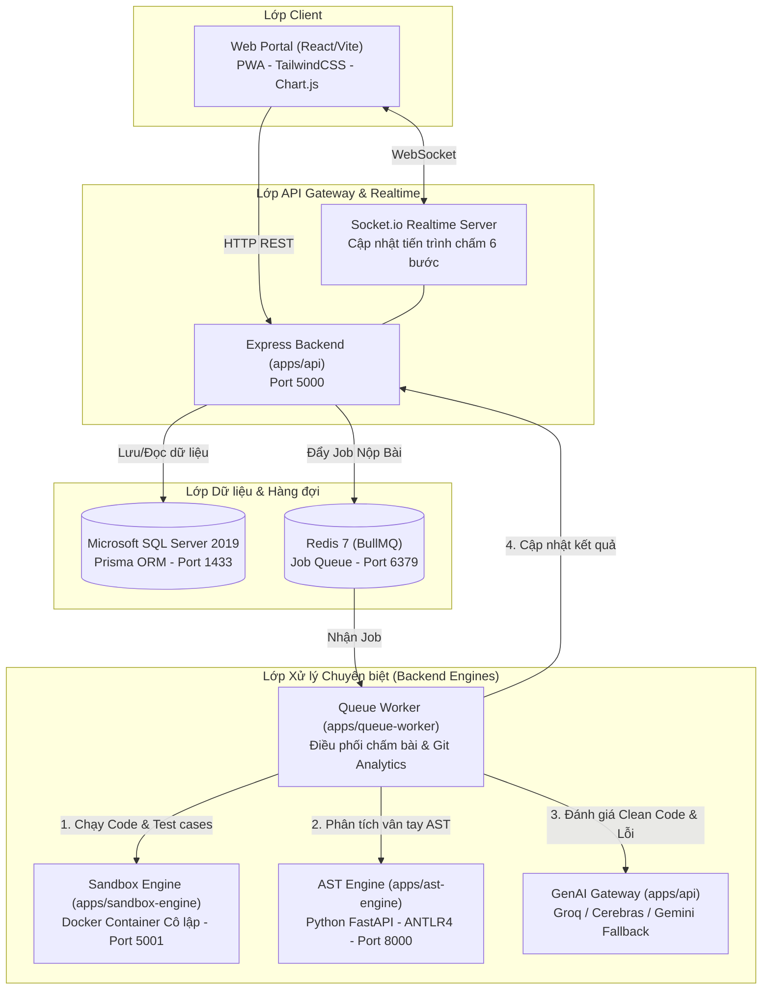
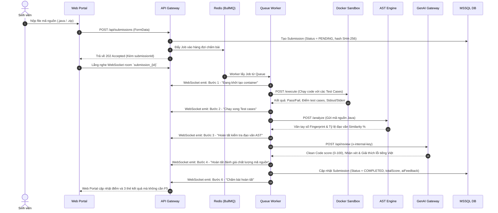
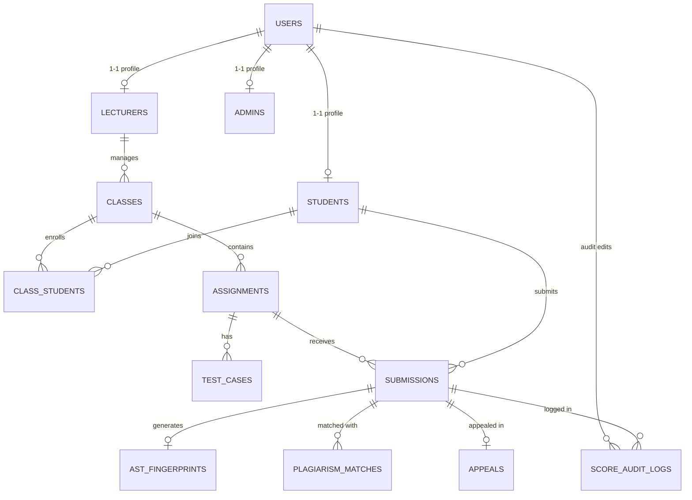

# 📚 TỔNG QUAN TOÀN BỘ DỰ ÁN AITA-INTELLIGENT (SWP391 — NHÓM 3)

> **Dự án:** AITA-Intelligent (AI-Powered Teaching Assistant & AST Code Analytics Platform)  
> **Môn học:** SWP391 — Software Development Project | **Học kỳ:** Fall 2026 — Đại học FPT  
> **Nhóm thực hiện:** Group 3  
> **Phiên bản SRS:** v1.2 Final | **Kiến trúc:** Monorepo đa dịch vụ (Node.js, TypeScript, Python FastAPI, Docker, MSSQL, Redis)  
> **Ngày tổng hợp:** 14/10/2026  

---

## 📑 MỤC LỤC
1. [Giới thiệu Dự án & Mục tiêu cốt lõi](#1-giới-thiệu-dự-án--mục-tiêu-cốt-lõi)
2. [Phân công Thành viên & 5 Phân hệ chính](#2-phân-công-thành-viên--5-phân-hệ-chính)
3. [Cấu trúc Thư mục Monorepo Toàn diện](#3-cấu-trúc-thư-mục-monorepo-toàn-diện)
4. [Kiến trúc Kỹ thuật & Tech Stack](#4-kiến-trúc-kỹ-thuật--tech-stack)
5. [Luồng Xử lý Dữ liệu End-to-End (E2E Pipeline)](#5-luồng-xử-lý-dữ-liệu-end-to-end-e2e-pipeline)
6. [Chi tiết 5 Phân hệ Chức năng](#6-chi-tiết-5-phân-hệ-chức-năng)
7. [Cơ sở Dữ liệu & Data Models (MSSQL + Prisma)](#7-cơ-sở-dữ-liệu--data-models-mssql--prisma)
8. [Danh mục API Endpoints & Contracts Nội bộ](#8-danh-mục-api-endpoints--contracts-nội-bộ)
9. [Lộ trình Triển khai qua các Milestone (Tuần 1 - 10)](#9-lộ-trình-triển-khai-qua-các-milestone-tuần-1---10)
10. [Hướng dẫn Cài đặt & Khởi chạy Hệ thống](#10-hướng-dẫn-cài-đặt--khởi-chạy-hệ-thống)

---

## 1. GIỚI THIỆU DỰ ÁN & MỤC TIÊU CỐT LÕI

### 1.1. Bối cảnh & Vấn đề thực tế
Trong đào tạo lập trình tại các trường đại học công nghệ, việc chấm bài thủ công gặp nhiều bất cập:
- Giảng viên tốn nhiều giờ để biên dịch, chạy test case và kiểm tra gian lận sao chép mã nguồn.
- Sinh viên nhận phản hồi trễ, thông báo lỗi biên dịch thô ráp từ compiler khó hiểu đối với sinh viên năm nhất/năm hai.
- Các công cụ kiểm tra đạo văn truyền thống (chỉ so khớp chuỗi văn bản) dễ bị qua mặt bằng các thủ thuật đổi tên biến, đảo hàm, thay đổi chú thích.

### 1.2. Giải pháp AITA-Intelligent
AITA-Intelligent là nền tảng trợ giảng thông minh tích hợp 4 công nghệ đột phá:
1. **Chấm mã nguồn tự động an toàn (Automated Grading):** Chạy code trong môi trường Docker Sandbox cô lập tuyệt đối (giới hạn RAM, CPU, cô lập mạng, chống fork-bomb).
2. **Kiểm tra đạo văn cấu trúc AST kết hợp Winnowing (RBL Core):** Bóc tách cây cú pháp trừu tượng (Abstract Syntax Tree), chuẩn hóa danh xưng rồi băm vân tay số (fingerprint), phát hiện gian lận dù đã đổi tên biến hoặc xáo trộn code.
3. **Trí tuệ nhân tạo GenAI hỗ trợ học tập:**
   - Đánh giá chất lượng mã nguồn Clean Code (0 - 100) kèm phản hồi tiếng Việt theo phương pháp Chain-of-Thought và Few-Shot Learning (US-15).
   - Giải thích lỗi biên dịch thân thiện bằng tiếng Việt cho sinh viên (NFR-17).
   - Tự động sinh đề bài kèm bộ test case mẫu cho giảng viên (US-08).
4. **Xử lý bất đồng bộ & cập nhật thời gian thực:** Sử dụng Redis + BullMQ điều phối hàng đợi và Socket.io đẩy tiến trình 6 bước trực tiếp lên Web Portal sinh viên.

---

## 2. PHÂN CÔNG THÀNH VIÊN & 5 PHÂN HỆ CHÍNH

Dự án được phân bổ cố định cho 5 kỹ sư phát triển theo 5 phân hệ chuyên trách:

| Thành viên | Phân hệ đảm nhiệm | Trách nhiệm chính | Tech Stack chính |
|:---|:---|:---|:---|
| **An** | **Phân hệ 1:** Web Portal & API Gateway / Auth | Giao diện sinh viên & giảng viên (React/Vite), SSO Google (`@fpt.edu.vn`), CRUD lớp học, đề bài, quản lý bài nộp, database MSSQL + Prisma ORM, Socket.io Server/Client. | React, TypeScript, Express, Prisma, MSSQL, Socket.io |
| **Thiên** | **Phân hệ 2:** Docker Sandbox Autograding | Môi trường thực thi code cô lập (`sandbox-engine`), Dockerode, kiểm soát tài nguyên (RAM 512MB, CPU 1 core, `--network=none`, seccomp profile, diệt fork bomb / loop). | Node.js, Docker, Dockerode, Bash |
| **Huy** *(Bạn)* | **Phân hệ 3:** GenAI Core & Review Hub | AI Gateway đa tầng fallback (Groq Llama-3.3-70B, Cerebras, Gemini), US-08 sinh đề bài, US-15 chấm Clean Code, NFR-17 giải thích lỗi biên dịch tiếng Việt, Benchmark đo P95 latency. | TypeScript, Axios, Groq SDK, Cerebras, Google GenAI SDK |
| **Nhật** | **Phân hệ 4:** AST Plagiarism Engine *(RBL Core)* | Động cơ phân tích cú pháp AST độc lập bằng Python FastAPI, ANTLR4 Java Parser, thuật toán Winnowing sinh fingerprint, so khớp độ tương đồng chống gian lận. Nghiên cứu khoa học IEEE. | Python 3.11, FastAPI, ANTLR4, Winnowing Algorithm |
| **Thịnh** | **Phân hệ 5:** Queue Worker & Git Analytics | Hàng đợi BullMQ + Redis, Worker điều phối toàn bộ chuỗi chấm bài (Sandbox → AST → GenAI → API), phân tích lịch sử commit Git để đo lường mức độ đóng góp nhóm. | TypeScript, BullMQ, Redis, Simple-Git, Docker |

---

## 3. CẤU TRÚC THƯ MỤC MONOREPO TOÀN DIỆN

```
SWP391_Group3/
├── .github/                       # CI/CD Workflows, GitHub Actions
├── apps/                          # Thư mục chứa toàn bộ các microservices / applications
│   ├── api/                       # [PHÂN HỆ 1 & 3] Express Backend API Gateway & GenAI Hub
│   │   ├── prisma/                # Prisma schema cho MSSQL & Migrations
│   │   │   └── schema.prisma      # 13 Data Models & Indexes tối ưu
│   │   ├── src/
│   │   │   ├── config/            # Cấu hình biến môi trường (env.ts)
│   │   │   ├── controllers/       # Controller: auth, class, assignment, submission, genai
│   │   │   ├── middlewares/       # Middleware: authenticateJWT, authorizeRole, requireInternalApiKey
│   │   │   ├── routes/            # Routes: auth, class, assignment, submission, genai
│   │   │   ├── services/
│   │   │   │   └── genai/         # [PHÂN HỆ 3 - HUY] Kiến trúc lõi GenAI
│   │   │   │       ├── types.ts           # Interfaces, AIRequest, AIResponse, Enums
│   │   │   │       ├── gateway.ts         # AIGateway 2 tầng Fallback + Safe Circuit
│   │   │   │       ├── providers/         # Strategy: Groq, Cerebras, Gemini, Factory
│   │   │   │       ├── prompts/           # Prompts: US-08, US-15, NFR-17
│   │   │   │       ├── benchmark/         # Script đo hiệu năng run.ts
│   │   │   │       └── __tests__/         # Unit tests cho Gateway & Prompts
│   │   │   ├── socket/            # Cấu hình Socket.io realtime tiến trình chấm
│   │   │   └── index.ts           # HTTP Server Bootstrap
│   │   └── package.json
│   │
│   ├── web/                       # [PHÂN HỆ 1 - AN] Giao diện người dùng Web Portal (PWA)
│   │   ├── src/
│   │   │   ├── components/        # UI Components: Header, Sidebar, Stepper, Charts
│   │   │   ├── pages/             # Login SSO, Student Dashboard, Submission, Lecturer Dashboard
│   │   │   ├── services/          # API Client, Socket listener
│   │   │   └── App.tsx
│   │   ├── vite.config.ts
│   │   └── package.json
│   │
│   ├── queue-worker/              # [PHÂN HỆ 5 - THỊNH] BullMQ Worker & Điều phối chấm bài
│   │   ├── src/
│   │   │   ├── clients/           # HTTP Clients: sandbox.client, ast.client, genai.client, api.client
│   │   │   ├── contracts/         # Contract types: genai.contract.ts, ast.contract.ts
│   │   │   ├── worker/            # BullMQ Processor, error-classifier, pipeline runner
│   │   │   ├── git-analytics/     # Trích xuất commit & đóng góp thành viên
│   │   │   └── index.ts           # Worker Bootstrap
│   │   └── Dockerfile
│   │
│   ├── ast-engine/                # [PHÂN HỆ 4 - NHẬT] Động cơ phát hiện đạo văn AST (Python)
│   │   ├── grammar/               # ANTLR4 Java grammar (.g4 files)
│   │   ├── src/
│   │   │   ├── parser/            # Trình biên dịch AST Java sang cấu trúc cây chuẩn
│   │   │   ├── normalizer/        # Xóa tên biến, hàm, chuẩn hóa hằng số
│   │   │   ├── winnowing/         # Thuật toán băm k-gram (k=25, w=40)
│   │   │   └── main.py            # FastAPI App: POST /analyze, POST /compare
│   │   ├── requirements.txt
│   │   └── Dockerfile
│   │
│   ├── sandbox-engine/            # [PHÂN HỆ 2 - THIÊN] Docker Sandbox cô lập thực thi code
│   │   ├── src/
│   │   │   ├── runner/            # Dockerode container spawn, execute, timeout, kill
│   │   │   ├── security/          # Seccomp filter, resource limits, malicious detectors
│   │   │   └── server.ts          # Internal API: POST /execute
│   │   └── Dockerfile
│   │
│   └── mobile/                    # Mobile app client (Future scope)
│
├── docs/                          # Kho tài liệu toàn diện dự án
│   ├── 01_SRS/                    # Bản đặc tả yêu cầu phần mềm v1.2 Final (PDF & Markdown)
│   ├── 02_Design_Artefacts/       # Sơ đồ UseCase, Sequence, ERD, High-Level Architecture, UI Mockups
│   ├── 03_Database/               # Hướng dẫn chạy MSSQL, Data Dictionary chi tiết
│   ├── 04_context/                # Ngữ cảnh phát triển từng phân hệ, tài liệu họp nhóm
│   ├── 05_plan/                   # Kế hoạch chi tiết Milestone 2, Milestone 3, ADRs, Task chia việc
│   ├── 06_Tutorial/               # Hướng dẫn dev mới onboarding
│   ├── ieee-paper/                # Đề cương bài báo khoa học nghiên cứu AST Winnowing
│   ├── request/                   # Biên bản bàn giao contract & bug giữa các phân hệ
│   └── stress-test/               # Script k6 đo tải hệ thống nộp bài hàng loạt
│
├── docker-compose.yml             # Cấu hình container hạ tầng: MSSQL Server, Redis, Worker, AST Engine
├── package.json                   # Root workspace config (npm/pnpm workspaces)
└── README.md                      # Giới thiệu dự án
```

---

## 4. KIẾN TRÚC KỸ THUẬT & TECH STACK



---

## 5. LUỒNG XỬ LÝ DỮ LIỆU END-TO-END (E2E PIPELINE)

Quy trình nộp và chấm bài tự động gồm 6 bước khép kín:



---

## 6. CHI TIẾT 5 PHÂN HỆ CHỨC NĂNG

### 🔹 Phân hệ 1: Web Portal & Core API Gateway (Dev An)
- **Xác thực SSO Google:** Chỉ chấp nhận tài khoản có tên miền `@fpt.edu.vn` hoặc `@fe.edu.vn`. Phát sinh JWT Token stateless chứa thông tin role (`STUDENT`, `LECTURER`, `ADMIN`).
- **Giao diện Sinh viên:**
  - Danh sách bài tập, hạn chót nộp bài, điểm số bài cũ.
  - Form nộp bài kéo thả, kiểm tra dung lượng tối đa 10MB.
  - Stepper 6 bước chấm bài realtime qua Socket.io.
  - 3 thẻ hiển thị kết quả trực quan:
    1. *Test Cases Card:* Số test pass/fail, thời gian chạy, bộ nhớ tiêu thụ.
    2. *Code Quality Card:* Điểm Clean Code 0-100 do AI chấm kèm góp ý cải thiện.
    3. *Plagiarism Check Card:* Đèn giao thông 3 mức (Xanh <30%, Vàng 30-60%, Đỏ >60% giữ điểm cảnh cáo).
  - Form khiếu nại điểm (Appeal) trực tuyến đến giảng viên.
- **Giao diện Giảng viên:**
  - Quản lý lớp học (Class), import danh sách sinh viên qua file Excel `.xlsx` (sử dụng DB Transaction an toàn).
  - Tạo đề bài (Assignment), định nghĩa danh sách Test Case ẩn/hiện, trọng số điểm từng case.
  - Bảng thống kê phân phối điểm lớp học, danh sách Top-10 cặp bài nộp có độ tương đồng AST cao nhất.

### 🔹 Phân hệ 2: Docker Autograding Sandbox (Dev Thiên)
- **Công nghệ cốt lõi:** Điều khiển Docker Engine trực tiếp thông qua thư viện `dockerode`.
- **Rào chắn bảo mật 4 lớp (Security Hardening):**
  1. *Resource Constraints:* `--memory=512m`, `--cpus=1`, swap bị vô hiệu hóa.
  2. *Network Isolation:* `--network=none` triệt để ngăn chặn code sinh viên gọi HTTP ra ngoài hoặc gửi thông tin mật.
  3. *Privilege Escalation Prevention:* Chạy bằng non-root user bên trong container, bật cờ `--read-only` root filesystem (chỉ cho phép ghi tại thư mục tạm `/tmp`).
  4. *Kernel Protection:* Áp dụng Seccomp profile tùy chỉnh, giới hạn process `--pids-limit=64` (ngăn chặn triệt để fork-bomb).
- **Cơ chế thu dọn rác:** Tự động gọi `docker rm -f` sau khi thực thi hoặc khi chạm ngưỡng timeout 30 giây (NFR-14).

### 🔹 Phân hệ 3: GenAI Core & Review Hub (Dev Huy)
- **Kiến trúc Gateway Đa tầng (Multi-Provider Strategy):**
  - **Primary Provider:** Groq Cloud (Model `qwen/qwen3.8-27b`) — ưu tiên số 1 vì tốc độ suy luận cực nhanh (~500ms).
  - **Fallback Provider:** Google Gemini (Model `gemini-2.5-flash`) — tự động chuyển đổi khi Groq chạm giới hạn 429 hoặc lỗi 5xx.
  - **Dự phòng mở rộng:** Cerebras Cloud (`llama-3.3-70b`).
  - **Xoay vòng đa khóa (Multi-key Pool):** Tự động phân giải danh sách keys từ `GROQ_API_KEYS`, xoay vòng round-robin, tự động cooldown 60s khi gặp 429 và vô hiệu hóa key khi gặp 401/403.
  - **Trần Deadline & Timeout:** Giới hạn mỗi provider 15s, trần tổng deadline 40s (`AI_TOTAL_DEADLINE_MS`).
  - **Cơ chế An toàn (Fail-Open Circuit Breaker):** Khi tất cả providers gặp sự cố hoặc hết deadline, hệ thống trả về `reviewStatus: "PENDING"` kèm `cleanCodeScore: null` (bất biến: không được trả 0 hay 100), bảo toàn pipeline chấm bài.
- **Bảo mật & Phòng chống Gian lận (Prompt Injection Security):**
  - Bọc mã nguồn sinh viên trong thẻ đóng mở `<student_code> ... </student_code>`.
  - Escape toàn bộ các thẻ `<student_code>` và `</student_code>` xuất hiện bên trong bài nộp của sinh viên nhằm ngăn chặn tuyệt đối kỹ thuật tấn công bẻ gãy prompt (Jailbreak / Prompt Injection).
  - Ép buộc định dạng cấu trúc JSON (`jsonMode: true` / `response_format`) ở mọi provider để triệt tiêu hiện tượng output lạc đề hoặc markdown thừa.
- **Tối ưu Hiệu năng & Cache:**
  - **SHA-256 Cache:** Băm mã nguồn sinh viên + ngôn ngữ + phiên bản prompt (`us15-v2`), lưu trữ trên Redis với TTL 7 ngày. Khi sinh viên nộp lại bài cũ, trả kết quả tức thì (0ms LLM cost). Thiết kế Fail-Open (Redis timeout 300ms thì tự động gọi LLM bình thường).
- **Tính năng triển khai:**
  - **US-15 (Clean Code Review):** Đánh giá theo 4 trụ cột (Đặt tên, Nguyên lý SOLID, Xử lý lỗi, Kiến trúc mã nguồn) kèm phương pháp Chain-of-Thought.
  - **NFR-17 (Error Explanation):** Chuyển đổi mã lỗi compiler khô khan thành hướng dẫn trợ giảng thân thiện bằng tiếng Việt kèm gợi ý sửa lỗi cụ thể (bài lỗi biên dịch nhận `cleanCodeScore: 0` khi AI thành công, hoặc `null` khi PENDING).
  - **US-08 (Assignment Generation):** Tự động sinh đề bài nháp kèm 3-5 test case chuẩn (có trọng số điểm cộng lại bằng 100) cho giảng viên dựa trên chủ đề và độ khó. Giới hạn tần suất 5 lần/phút/IP (`express-rate-limit`).

### 🔹 Phân hệ 4: AST Plagiarism Detection Engine (Dev Nhật — RBL Core)
- **Cơ sở khoa học:** Nghiên cứu bài toán gian lận mã nguồn trong môi trường giáo dục (kết hợp đề cương nghiên cứu IEEE).
- **Quy trình Winnowing trên cây AST:**
  1. Sử dụng bộ ngữ pháp ANTLR4 phân tích code Java thành Abstract Syntax Tree.
  2. *Chuẩn hóa AST (Normalization):* Loại bỏ hoàn toàn tên biến, tên hàm, chú thích (comment), thụt đầu dòng; đưa về cây cấu trúc chuẩn.
  3. *Tạo k-gram & Vân tay (Fingerprinting):* Băm các chuỗi token với tham số chuẩn $k = 25$, kích thước cửa sổ trượt $w = 40$.
  4. *So khớp Jaccard:* So sánh tập vân tay giữa các bài nộp trong cùng bài tập để tính toán tỷ lệ `similarity_percent`. Vượt ngưỡng 60% sẽ tự động đánh dấu cảnh báo `SCORE_WITHHELD`. Vượt qua bài kiểm tra chéo P2P với độ chính xác >80%.

### 🔹 Phân hệ 5: Queue Worker & Teamwork Git Analytics (Dev Thịnh)
- **Hàng đợi phân tán BullMQ:** Đảm bảo thứ tự bài nộp (FIFO), hỗ trợ cơ chế retry tự động tối đa 3 lần với thuật toán exponential backoff nếu Sandbox hoặc AST Engine tạm thời bận.
- **Đóng gói Docker:** Triển khai độc lập trong container `aita_queue_worker`.
- **Git Analytics:** Tự động clone hoặc đọc log repository của sinh viên/nhóm làm bài tập lớn, tính toán số dòng thêm/xóa (churn rate), tần suất commit theo thời gian để phát hiện hiện tượng "gánh team" hoặc commit dồn vào phút chót.

---

## 7. CƠ SỞ DỮ LIỆU & DATA MODELS (MSSQL + PRISMA)

Hệ thống sử dụng **Microsoft SQL Server 2019** với 13 bảng được ánh xạ qua **Prisma ORM**, bao gồm đầy đủ các ràng buộc khóa ngoại và chỉ mục hiệu năng (Performance Indexes):



### Chi tiết các thực thể dữ liệu chính:

1. **`users`:** Thông tin tài khoản (`id`, `email`, `password_hash`, `full_name`, `role: STUDENT | LECTURER | ADMIN`, `created_at`).
2. **`students`:** Hồ sơ sinh viên (`user_id`, `student_code`, `major`, `intake_year`).
3. **`lecturers`:** Hồ sơ giảng viên (`user_id`, `department`, `title`, `lecturer_code`).
4. **`classes`:** Lớp học (`id`, `lecturer_id`, `class_code`, `name`, `semester`).
5. **`class_students`:** Quan hệ sinh viên - lớp (`class_id`, `student_id`, `enrolled_at`, `status`).
6. **`assignments`:** Đề bài lập trình (`id`, `class_id`, `title`, `description`, `language: Java | Python | C#`, `deadline`, `grading_criteria`).
7. **`test_cases`:** Bộ test case kiểm thử (`id`, `assignment_id`, `input_data`, `expected_output`, `score_weight`).
8. **`submissions`:** Bài nộp (`id`, `assignment_id`, `student_id`, `file_url`, `file_hash`, `status: PENDING | RUNNING | COMPLETED | SCORE_WITHHELD | FAILED`, `total_score`, `ai_feedback`, `ast_check_status`).
9. **`ast_fingerprints`:** Vân tay số lưu trữ cấu trúc code (`id`, `submission_id`, `fingerprint_data`, `analysis_mode`, `warnings`).
10. **`plagiarism_matches`:** Kết quả so khớp đạo văn (`id`, `submission_1_id`, `submission_2_id`, `similarity_percent`, `level: SAFE | WARNING | DANGER`, `matched_fragments`).
11. **`appeals`:** Đơn khiếu nại điểm (`id`, `submission_id`, `student_id`, `resolved_by`, `reason`, `status: PENDING | APPROVED | REJECTED`, `lecturer_response`).
12. **`score_audit_logs`:** Nhật ký lịch sử sửa điểm phục vụ bảo vệ đồ án (`id`, `submission_id`, `editor_id`, `old_score`, `new_score`, `reason`, `created_at`).

---

## 8. DANH MỤC API ENDPOINTS & CONTRACTS NỘI BỘ

### 8.1. Public & Portal APIs (Người dùng gọi)

| Phương thức | Đường dẫn URL | Quyền hạn | Mô tả chức năng |
|:---|:---|:---:|:---|
| `POST` | `/api/auth/google` | Public | Đăng nhập SSO bằng Google account `@fpt.edu.vn` |
| `GET` | `/api/classes` | Authenticated | Lấy danh sách lớp học theo tài khoản |
| `POST` | `/api/classes` | Lecturer / Admin | Tạo lớp học mới |
| `POST` | `/api/classes/:id/import-students` | Lecturer / Admin | Import sinh viên từ file Excel `.xlsx` |
| `GET` | `/api/assignments` | Authenticated | Xem danh sách bài tập |
| `POST` | `/api/assignments` | Lecturer / Admin | Tạo đề bài kèm các test case |
| `POST` | `/api/assignments/clone` | Lecturer / Admin | Sao chép đề bài cũ sang lớp học mới |
| `POST` | `/api/assignments/generate` | Lecturer / Admin | **[GenAI US-08]** AI tự động sinh đề bài theo chủ đề |
| `POST` | `/api/submissions` | Student | Nộp bài code (.zip / .java), đẩy vào Queue |
| `GET` | `/api/submissions/:id` | Authenticated | Xem chi tiết kết quả chấm bài của sinh viên |
| `POST` | `/api/submissions/:id/appeal` | Student | Gửi đơn khiếu nại điểm |
| `GET` | `/api/dashboard/lecturer` | Lecturer / Admin | Lấy số liệu thống kê lớp học & Top-10 đạo văn |

### 8.2. Internal Service APIs (Giao tiếp bảo mật bằng `x-internal-key`)

```typescript
// Header bắt buộc cho tất cả các request nội bộ:
headers: {
  "x-internal-key": process.env.INTERNAL_API_KEY // Mặc định: "aita_internal_secret_key_2026"
}
```

1. **POST `/api/review` (Worker gọi GenAI Gateway):**
   - **Request Payload:**
     ```json
     {
       "submissionId": "sub-123456",
       "language": "Java",
       "sourceCode": "public class Solution { ... }",
       "isCompilationError": false,
       "compileOutput": "",
       "sandboxSummary": { "passedTests": 5, "totalTests": 5 }
     }
     ```
   - **Response Payload:**
     ```json
     {
       "cleanCodeScore": 88,
       "feedback": "Mã nguồn rõ ràng, áp dụng tốt nguyên lý đóng gói...\n- Đặt tên hàm chuẩn CamelCase.",
       "compilationExplanation": null
     }
     ```

2. **POST `/api/internal/submissions/:id/ast-check` (Worker ghi kết quả AST):**
   - Nhận kết quả fingerprint và cập nhật trạng thái `astCheckStatus: "DONE"`.

---

## 9. LỘ TRÌNH TRIỂN KHAI QUA CÁC MILESTONE (TUẦN 1 - 10)

```
Tuần 1 - 2: Khởi động & Đặc tả yêu cầu (SRS v1.0, ERD, Kiến trúc Monorepo)
├── Đã hoàn thành 100%

Tuần 3 - 5: MILESTONE 2 (Core Workflow Từng Phân Hệ Riêng Lẻ)
├── Phân hệ 1 (An): Login SSO, Dashboard cơ bản, Tạo đề, Migrate 10 bảng DB
├── Phân hệ 2 (Thiên): Setup Docker Sandbox, cô lập tài nguyên, chống fork bomb
├── Phân hệ 4 (Nhật): Xây dựng AST Engine (FastAPI), chuẩn hóa mã nguồn, test P2P >80%
├── Phân hệ 5 (Thịnh): Cấu hình Redis Queue, BullMQ nhận bài
└── Phân hệ 3 (Huy): Đăng ký key Groq/Cerebras, hoàn thành Gateway & Prompts
    └── Đã hoàn thành 95% (Đạt tiêu chuẩn Milestone 2)

Tuần 6 - 8: MILESTONE 3 (Tích Hợp Toàn Diện & Đánh Giá Chất Lượng)
├── Nối toàn bộ pipeline End-to-End từ Web -> Queue -> Sandbox -> AST -> GenAI
├── Hoàn thiện tính năng Appeals (Khiếu nại điểm) & Git Analytics (Đo đóng góp)
├── Phân hệ 3 (Huy): Expose Route/Controller cho GenAI, chạy Benchmark xuất CSV
└── Kiểm thử UAT chống lỗi chéo P2P giữa các nhóm

Tuần 9 - 10: MILESTONE 4 & 5 (Stress Test, Bảo Vệ Đồ Án & Xuất Bản IEEE)
├── Chạy k6 Stress-test 100 bài nộp đồng thời không nghẽn hệ thống
├── Hoàn thiện bài báo khoa học nghiên cứu AST Winnowing (IEEE Format)
└── Đóng gói Docker Compose nghiệm thu bảo vệ trước Hội đồng
```

---

## 10. HƯỚNG DẪN CÀI ĐẶT & KHỞI CHẠY HỆ THỐNG

### 10.1. Yêu cầu Tiên quyết
- Node.js >= 20.x, npm >= 10.x
- Python >= 3.11 (phục vụ AST Engine)
- Docker Desktop đang chạy (hỗ trợ Linux containers)
- Git CLI

### 10.2. Cấu hình Biến môi trường (`apps/api/.env`)
```env
PORT=5000
DATABASE_URL=sqlserver://localhost:1433;database=AITA_DB;user=sa;password=AitaPassword123!;encrypt=false;trustServerCertificate=true
JWT_SECRET=aita_jwt_secret_key_fall_2026_super_secure
INTERNAL_API_KEY=aita_internal_secret_key_2026

# GenAI Credentials (Phân hệ 3)
GROQ_API_KEY=gsk_your_groq_api_key_here
CEREBRAS_API_KEY=csk_your_cerebras_api_key_here
GEMINI_API_KEY=AIzaSy_your_gemini_api_key_here
AI_PRIMARY_PROVIDER=groq
AI_FALLBACK_PROVIDER=cerebras
AI_REQUEST_TIMEOUT_MS=15000
```

### 10.3. Khởi chạy Hệ thống Bằng Docker Compose
Chạy toàn bộ hạ tầng cơ sở dữ liệu và các engine xử lý:
```bash
# Tại thư mục gốc của dự án
docker-compose up -d mssql redis ast-engine
```

### 10.4. Khởi chạy Backend API Gateway & Frontend
```bash
# 1. Chạy Backend API (Port 5000)
cd apps/api
npm install
npx prisma db push       # Đồng bộ schema lên MSSQL
npm run dev

# 2. Chạy Frontend Web Portal (Port 5173)
cd ../web
npm install
npm run dev

# 3. Chạy Queue Worker (Background Processor)
cd ../queue-worker
npm install
npm run dev
```

---

*Tài liệu tổng quan này được biên soạn đầy đủ, hệ thống hóa toàn bộ mã nguồn, cơ sở dữ liệu và quy trình hoạt động của dự án AITA-Intelligent.*
