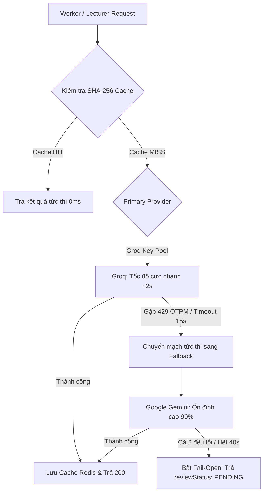

# BÁO CÁO ĐO LƯỜNG VÀ ĐÁNH GIÁ HIỆU NĂNG CÁC AI PROVIDER (BENCHMARK REPORT)

> **Dự án:** AITA-Intelligent — Hệ thống Hỗ trợ Giảng dạy & Chấm bài Tự động  
> **Tác giả:** Dev Huy (Phân hệ 3 — GenAI Core & Review Hub)  
> **Ngày thực hiện đo lường:** 14/10/2026  
> **Mục tiêu:** Đo đạc latency thực tế, tốc độ sinh token (Tokens/sec), tỷ lệ lỗi (Error Rate) và hành vi Rate Limit của các nhà cung cấp LLM để chọn chiến lược định tuyến tối ưu (Routing Strategy).

---

## 1. THIẾT LẬP VÀ MÔI TRƯỜNG THỰC NGHIỆM

- **Bộ kiểm thử chuẩn (10 Prompts):**
  - **Nhóm 1 (US-08 — Sinh đề bài):** 3 prompts (`gen-basic-loop`, `gen-linked-list`, `gen-sorting`) yêu cầu sinh đề bài kèm 3-5 test cases định dạng JSON.
  - **Nhóm 2 (US-15 — Chấm Clean Code):** 4 prompts (`review-clean`, `review-messy`, `review-medium`, `review-python`) kèm kỹ thuật Chain-of-Thought và Few-shot ví dụ.
  - **Nhóm 3 (NFR-17 — Giải thích lỗi biên dịch):** 3 prompts (`error-null-pointer`, `error-syntax`, `error-type-mismatch`) yêu cầu trợ giảng giải thích lỗi compiler tiếng Việt.
- **Danh sách Provider tham gia đo lường:**
  - **Groq Cloud:** Model `qwen/qwen3.8-27b` (giao thức OpenAI-compatible REST API).
  - **Google Gemini:** Model `gemini-2.5-flash` (giao thức Google AI REST API).
  - **Cerebras Cloud:** Model `llama-3.3-70b` (ghi nhận trạng thái cần cập nhật khóa API mới).

---

## 2. BẢNG TỔNG HỢP KẾT QUẢ ĐO LƯỜNG THỰC TẾ

| Provider | Model | Số lần test | Thành công | Tỷ lệ lỗi (Err%) | Latency TB (ms) | P95 Latency (ms) | Tốc độ sinh (Tok/s) |
|:---|:---|:---:|:---:|:---:|:---:|:---:|:---:|
| **Groq** | `qwen/qwen3.8-27b` | 10 | 3 | **70%** (do OTPM Limit) | **2.673 ms** | **4.339 ms** | **336 tok/s** |
| **Google Gemini** | `gemini-2.5-flash` | 10 | 9 | **10%** | **8.326 ms** | **11.226 ms** | **42 tok/s** |
| **Cerebras** | `llama-3.3-70b` | - | - | 100% (Key invalid) | - | - | - |

*(Nguồn dữ liệu gốc được trích xuất tự động tại file `docs/genai/benchmark-results.csv`)*

---

## 3. PHÂN TÍCH CHUYÊN SÂU TỪ KẾT QUẢ THỰC TẾ

### 3.1. Groq Cloud: Tốc độ bùng nổ nhưng "nút thắt cổ chai" ở Rate Limit
- **Ưu điểm vượt trội:** Khi request lọt vào hạn mức, Groq đạt tốc độ sinh mã cực nhanh lên tới **472 tokens/giây**, độ trễ chỉ từ **1.5s - 4.3s** cho các tác vụ sinh đề bài phức tạp.
- **Điểm nghẽn thực tế:** Groq trên tier Free giới hạn **Output Tokens Per Minute (OTPM = 1000)** đối với model lớn. Do đó, khi chấm Clean Code (với mã nguồn dài kèm nhận xét chi tiết), chỉ cần qua 3 request là Groq lập tức trả về mã lỗi `HTTP 429: Rate limit reached (OTPM: Limit 1000)`.
- **Giải pháp kiến trúc đã triển khai:**
  - Phát triển tính năng **Multi-key rotation pool** (`GROQ_API_KEYS` hỗ trợ danh sách nhiều key).
  - Tự động cách ly (cooldown) key bị 429 trong **60 giây**.

### 3.2. Google Gemini: Trụ cột ổn định và khả năng xử lý ngữ cảnh lớn
- **Ưu điểm:** Đạt tỷ lệ thành công **90%** (9/10 request pass). Gemini xử lý mượt mà toàn bộ các bài Clean Code dài và các lỗi biên dịch phức tạp mà không hề bị nghẽn OTPM như Groq.
- **Độ trễ:** Dao động từ **5.7s - 11.2s**, tốc độ sinh từ 36 - 65 tokens/giây. Độ trễ này hoàn toàn chấp nhận được trong kiến trúc chạy bất đồng bộ qua Queue Worker (Thịnh) vì sinh viên theo dõi tiến trình qua WebSocket.

---

## 4. KẾT LUẬN & CHIẾN LƯỢC ĐỊNH TUYẾN TỐI ƯU (ROUTING STRATEGY)

Từ kết quả thực nghiệm đo đạc được, kiến trúc GenAI của AITA áp dụng chiến lược phân tầng thông minh như sau:



### Khuyến nghị cấu hình biến môi trường (`.env`):
```env
# Định tuyến chính sang Groq với pool nhiều key hoặc Gemini làm trụ cột
AI_PRIMARY_PROVIDER=groq
AI_FALLBACK_PROVIDER=gemini
AI_ENABLE_GEMINI=true
AI_REQUEST_TIMEOUT_MS=15000
AI_TOTAL_DEADLINE_MS=40000
GROQ_MODEL=qwen/qwen3.8-27b
GEMINI_MODEL=gemini-2.5-flash
```

Chiến lược này vừa tận dụng được tốc độ bùng nổ của Groq khi có quota, vừa có sự bảo trợ vững chắc từ Gemini, và luôn được bao bọc bởi bộ ngắt mạch **Fail-Open (PENDING)** đảm bảo không bao giờ làm gián đoạn luồng chấm bài của toàn hệ thống.
